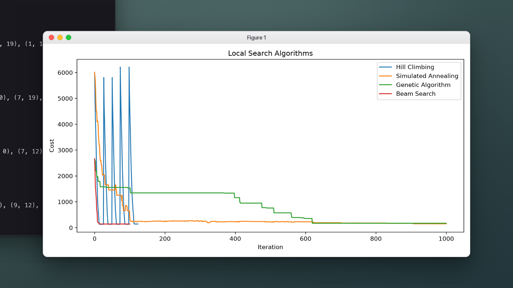

# Placing Sensors with Local Search

<sub>Project 2 · Local search and optimization</sub>

<p align="center">
  <a href="media/demo.mp4"></a>
</p>
<p align="center"><sub><code>python main.py</code> on map1 · click for the full-quality video</sub></p>

A grid holds targets and obstacles. Each sensor covers every cell within a fixed Manhattan distance, and only a limited number of sensors can be placed. The goal is to cover every target with as few sensors and as little overlapping coverage as possible.

The search space is far too large to enumerate, so four local search methods each improve a complete placement step by step.

## How it works

**Cost of a placement** (lower is better), in [`search/local_search_base.py`](search/local_search_base.py):

```
cost = 200 × uncovered targets  +  10 × sensors used  +  1 × overlapping covered cells
```

Missing a target dominates, then sensor count, then wasted overlap.

**Neighbours** of a placement: remove one sensor, add one sensor (candidates come from cells near uncovered targets, plus a few random cells), or move one sensor a single step.

| Algorithm | File | Configuration |
| :-- | :-- | :-- |
| Hill climbing | `hill_climbing.py` | Steepest descent, up to 8 sideways moves on plateaus, 4 random restarts |
| Simulated annealing | `simulated_annealing.py` | *T(t)* = 100 · 0.995<sup>t</sup>, random neighbour, worse moves accepted with probability *e*<sup>Δ/T</sup> |
| Genetic algorithm | `genetic_algorithm.py` | Population 30, fitness 1 / (1 + cost), fitness-weighted selection, one-point crossover, 10% mutation |
| Local beam search | `beam_search.py` | Keeps the 5 best distinct successors of the whole beam each step |

<p align="center">
  
</p>
<p align="center"><sub>Cost per iteration on map1. The hill-climbing spikes are random restarts; the genetic algorithm improves in discrete steps.</sub></p>

## Results

Final cost on each map, as recorded in the [report](report/main.pdf). All four methods are stochastic, so individual runs vary.

| Map | Hill climbing | Simulated annealing | Genetic algorithm | Beam search |
| :-- | --: | --: | --: | --: |
| map1 | **130** | 175 | 146 | **130** |
| map2 | **1,480** | 1,880 | **1,480** | **1,480** |
| map3 | 655 | **452** | 671 | 653 |
| map4 | **440** | **440** | **440** | **440** |
| map5 | **350** | 360 | 2,975 | **350** |
| map6 | **3,062** | 3,870 | 3,266 | 3,460 |
| map7 | **60** | 196 | 132 | 70 |

Hill climbing with restarts reaches the lowest cost on six of the seven maps, and beam search on four. Simulated annealing does best on map3.

## Run it

```bash
cd AI26-PRJ2
python -m venv .venv && source .venv/bin/activate
pip install -r reqirements.txt
python main.py
```

The program prints each algorithm's final placement and cost, opens the cost chart, and, once the chart is closed, animates every search in a pygame window.

- Choose the map in `main.py` with `GridWorld("map1")`; maps are in [`env/maps/`](env/maps).
- The chart uses Matplotlib's TkAgg backend. With Homebrew Python on macOS you may need `brew install python-tk`.

**Map format.** Rows of `.` (empty), `T` (target) and `X` (obstacle), followed by two lines: the sensor range, then the maximum number of sensors.

## Project layout

```
AI26-PRJ2/
├── main.py                     runs all algorithms and shows the results
├── utils.py                    console output, chart, animation
├── env/                        grid world, renderer, maps
├── search/
│   ├── local_search_base.py    cost function and neighbourhood
│   ├── hill_climbing.py
│   ├── simulated_annealing.py
│   ├── genetic_algorithm.py
│   └── beam_search.py
└── report/                     write-up (Persian, PDF + LaTeX)
```

---

<sub>Part of [AI Projects](../README.md) · University of Isfahan · Artificial Intelligence, Spring 2026</sub>
