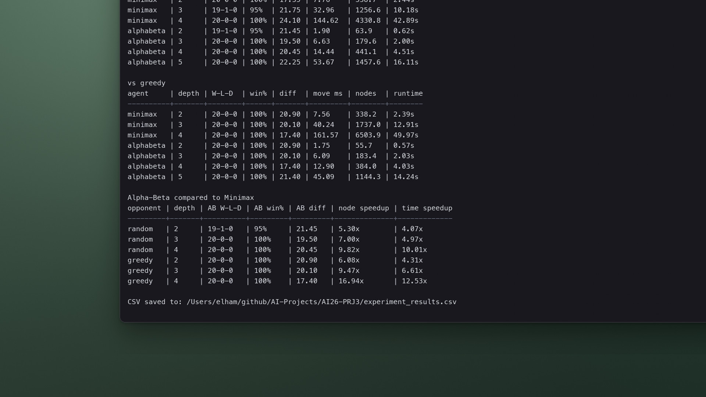

# Adversarial Search in Othello

<sub>Project 3 · Minimax and alpha-beta pruning</sub>

<p align="center">
  <a href="media/demo.mp4"></a>
</p>
<p align="center"><sub>A game between the project's agents, then <code>run_experiments.py</code> · click for the full-quality video</sub></p>

Two search agents play Othello on a 6 × 6 board: a plain minimax player and an alpha-beta player that prunes branches it can prove irrelevant. Both use the same evaluation function and move ordering, so at equal depth they choose the same moves. Alpha-beta just looks at far fewer positions to get there.

> The project itself runs in the terminal. The board view in the demo is a replay drawn from the moves of a real game between `AlphaBetaAgent(depth=4)` and `GreedyAgent`, with the nodes searched for each move.

## How it works

**Agents** (in [`agents/`](agents))

| Agent | Strategy |
| :-- | :-- |
| `RandomAgent` | Any legal move |
| `GreedyAgent` | The move that flips the most discs right now |
| `MinimaxAgent` | Depth-limited minimax |
| `AlphaBetaAgent` | Minimax with alpha-beta pruning |

Both search agents handle passes, and both search to the end of the game once six or fewer squares are empty.

**Evaluation** ([`agents/search_utils.py`](agents/search_utils.py)). A finished game scores ±1,000,000. Otherwise the position is a weighted sum of:

| Feature | Weight |
| :-- | :-- |
| Disc difference | 0 early, 1 mid-game, 4 late (by board fill) |
| Mobility, 100 · (mine − theirs) / (mine + theirs) | 1 |
| Corners held | 35 |
| Edge squares held | 2 |
| Discs next to an empty corner | −8 |
| Frontier discs (next to an empty square) | −1 |

**Move ordering.** Corners are tried first, then edges, then interior squares; squares that hand a corner to the opponent come last. Good ordering is what lets alpha-beta cut early.

## Results

Twenty games per match-up from two random opening moves, alternating colours. Figures are from the [report](report/main.pdf).

| Agent | Depth | vs Random | vs Greedy | Nodes / move (vs Greedy) | Time / move (vs Greedy) |
| :-- | :-: | :-: | :-: | --: | --: |
| Minimax | 2 | 20–0 | 20–0 | 223.6 | 9.4 ms |
| Minimax | 3 | 20–0 | 20–0 | 982.8 | 49.2 ms |
| Minimax | 4 | 20–0 | 20–0 | 4,346.9 | 213.0 ms |
| Alpha-beta | 2 | 20–0 | 20–0 | 43.9 | 2.7 ms |
| Alpha-beta | 3 | 20–0 | 20–0 | 160.5 | 11.3 ms |
| Alpha-beta | 4 | 20–0 | 20–0 | 374.0 | 23.3 ms |
| Alpha-beta | 5 | 20–0 | 20–0 | 1,233.8 | 84.2 ms |

**Alpha-beta against minimax at equal depth**

| Opponent | Depth | Node reduction | Speed-up |
| :-- | :-: | --: | --: |
| Random | 2 / 3 / 4 | 6.0× / 5.3× / 15.2× | 4.0× / 3.9× / 11.9× |
| Greedy | 2 / 3 / 4 | 5.1× / 6.1× / 11.6× | 3.5× / 4.4× / 9.2× |

The saving grows with depth. At depth 4 alpha-beta visits less than a tenth as many nodes, so even depth 5 is cheaper than minimax at depth 4.

<p align="center">
  
</p>
<p align="center"><sub>Output of <code>run_experiments.py</code>. Openings are random, so the numbers differ slightly from run to run.</sub></p>

## Run it

No third-party packages are needed.

```bash
cd AI26-PRJ3
python main.py              # one Greedy (black) vs Random (white) game; prints (black, white) disc counts
python run_experiments.py   # the full comparison, about 3 minutes; also writes experiment_results.csv
```

Board size, number of games, opponents and depths are constants at the top of `run_experiments.py`.

## Project layout

```
AI26-PRJ3/
├── main.py               single sample game
├── tournament.py         game loop between two agents
├── run_experiments.py    match-ups, tables and CSV
├── game/othello.py       board, legal moves, flipping
├── agents/               random, greedy, minimax, alpha-beta, evaluation
└── report/               write-up (Persian, PDF + LaTeX)
```

---

<sub>Part of [AI Projects](../README.md) · University of Isfahan · Artificial Intelligence, Spring 2026</sub>
