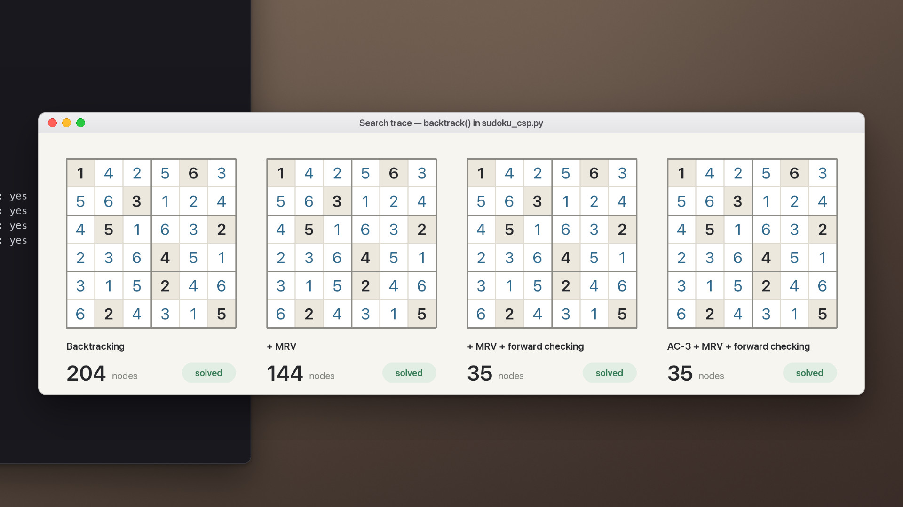
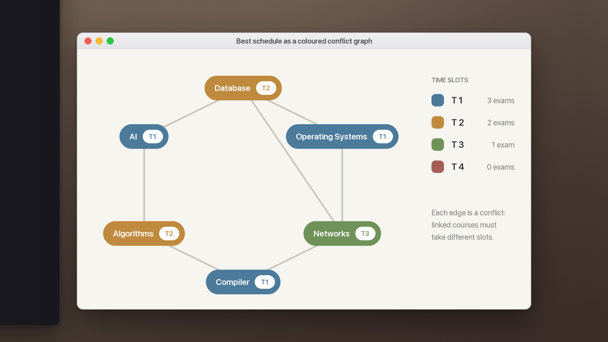

# Constraint Satisfaction

<sub>Project 4 · Backtracking, MRV, degree heuristic, forward checking and AC-3</sub>

<p align="center">
  <a href="media/demo.mp4"></a>
</p>
<p align="center"><sub><code>sudoku_csp.py</code> and <code>exam_scheduling_csp.py</code> · click for the full-quality video</sub></p>

Two problems are modelled as constraint satisfaction problems and solved with backtracking search. Each method adds one improvement, so the effect of every heuristic shows up in the node count. The [report](report/main.pdf) also works three smaller CSPs by hand: plain backtracking, MRV with the degree heuristic, and a step-by-step AC-3 trace.

> The project runs in the terminal. The board and graph views in the demo are drawn from the project's own output: the Sudoku boards replay a trace of `backtrack()` in `sudoku_csp.py`, recorded node by node.

## 6 × 6 Sudoku

**Model.** 36 variables, one per cell, with domain 1–6 (givens are fixed). Every cell must differ from its *peers*: the other cells in its row, its column and its 2 × 3 block.

| Method | Variable choice | Inference | Nodes generated |
| :-- | :-- | :-- | --: |
| Backtracking | Fixed order | — | 204 |
| + MRV | Fewest legal values | — | 144 |
| + MRV + forward checking | Smallest current domain | Prune peers' domains after each assignment | **35** |
| AC-3 + MRV + forward checking | Smallest current domain | Arc consistency first, then forward checking | **35** |

On this puzzle AC-3 alone settles the first two rows before search begins. The search that follows generates the same 35 nodes as forward checking alone.

<p align="center">
  
</p>
<p align="center"><sub>The same puzzle under all four methods. In the video each frame advances one generated node.</sub></p>

## Exam timetabling

**Model.** Six courses (AI, Database, Operating Systems, Networks, Compiler, Algorithms) are assigned to four time slots, T1–T4. Seven pairs of courses conflict and must take different slots, which makes this a graph-colouring problem.

| Method | Nodes to first solution |
| :-- | --: |
| Backtracking | 11 |
| + MRV | 11 |
| + MRV + degree heuristic | 13 |

Exhaustive search over the full space (1,365 nodes) finds **480** valid timetables, all written to `exam_scheduling_solutions.txt`. Minimising the use of the last slot, T4, gives an optimum of zero: **30** timetables need only three slots.

<p align="center">
  
</p>
<p align="center"><sub>The printed best schedule shown as a coloured conflict graph.</sub></p>

## Run it

No third-party packages are needed (Python 3.10 or newer).

```bash
cd AI26-PRJ4
python sudoku_csp.py             # puzzle, node counts per method, solution
python exam_scheduling_csp.py    # first solutions, all 480 schedules, best schedule
```

The puzzle (`INITIAL_GRID`), courses, slots and conflicts are defined at the top of each file.

## Project layout

```
AI26-PRJ4/
├── sudoku_csp.py             6 × 6 Sudoku: backtracking, MRV, forward checking, AC-3
├── exam_scheduling_csp.py    timetabling: backtracking, MRV, degree heuristic
└── report/                   write-up, including the hand-solved exercises (Persian)
```

---

<sub>Part of [AI Projects](../README.md) · University of Isfahan · Artificial Intelligence, Spring 2026</sub>
