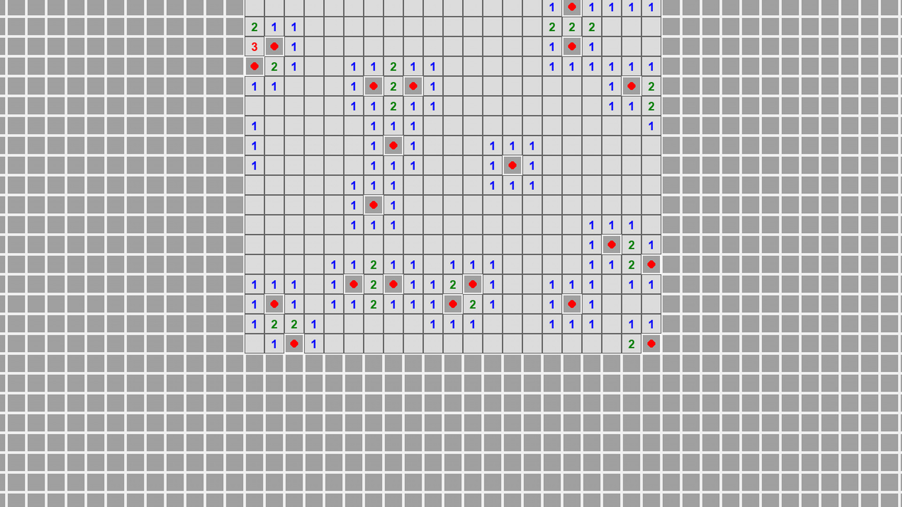

# Minesweeper, Solved with Logic

<sub>Project 5 · First-order logic and inference</sub>

<p align="center">
  <a href="media/demo.mp4"></a>
</p>
<p align="center"><sub>Manual mode, then the logic agent on a 45 × 80 board · click for the full-quality video</sub></p>

A Minesweeper agent that never looks at the hidden board. It keeps its own record of what it has seen and turns that into first-order facts. Rules in [pyDatalog](https://pypi.org/project/pyDatalog/) then decide which cells are certainly safe and which certainly hold a mine. The agent guesses only when no rule applies.

## How it works

Everything lives in [`main.py`](main.py); the game environment is in [`src/minesweeper.py`](src/minesweeper.py).

**Knowledge base.** `Adjacent(r, c, r2, c2)` is asserted once for every pair of neighbouring cells. On each turn, the agent's own board is rewritten as facts:

- `UnknownCell(r, c)`: not yet revealed or flagged
- `Value(r, c, n)`: a revealed clue that still has hidden neighbours
- `FlaggedNeighborCount(r, c, f)` and `HiddenNeighborCount(r, c, u)`

**Rules.**

```prolog
Safe(R2, C2) <= Value(R, C, N) & FlaggedNeighborCount(R, C, N)
                & Adjacent(R, C, R2, C2) & UnknownCell(R2, C2)

Mine(R2, C2) <= Value(R, C, N) & FlaggedNeighborCount(R, C, F) & HiddenNeighborCount(R, C, U)
                & (N == F + U) & (U > 0)
                & Adjacent(R, C, R2, C2) & UnknownCell(R2, C2)
```

*Safety:* if a clue's mines are all flagged, its other hidden neighbours are safe. *Danger:* if a clue needs every hidden neighbour to be a mine, flag them all.

**Frontier inference.** Some deductions need two clues at once. Each clue becomes a constraint of the form *these hidden cells hold k mines*. For two overlapping constraints A and B, suppose A has exactly as many extra mines as it has cells outside B. Then those cells are all mines, and B's cells outside A are all safe. Known cells are folded back in and the step repeats until nothing changes. It runs after the Datalog queries each turn.

**When logic runs out.** The agent estimates each frontier cell's mine probability from its neighbouring clues and reveals the least likely one. With no information at all, it picks a random unknown cell.

**Each turn:** update the facts → query `Safe` and `Mine` → reveal safe cells → flag mines → guess only if nothing changed.

<p align="center">
  
</p>
<p align="center"><sub>Mid-solve on the 45 × 80 board: revealed clues, flagged mines (red) and the hidden frontier around them.</sub></p>

## Results

From the [report](report/main.pdf):

| Board | Mines | Seed | Outcome | Cleared | Rounds | Safe cells deduced | Mines deduced | Time |
| :-- | --: | --: | :-- | --: | --: | --: | --: | --: |
| 9 × 9 | 9 | 99 | Win | 100% | 8 | 71 | 8 | 0.17 s |
| 15 × 15 | 35 | 42 | Win | 100% | 10 | 189 | 35 | 0.57 s |
| 20 × 20 | 75 | 123 | Loss after 11 guesses | 99.1% | 33 | 310 | 71 | 0.76 s |
| 45 × 80 | 200 | random | Win | 100% | 40 | 3,399 | 196 | 8.41 s |

The dense 20 × 20 board (19% mines) eventually needs guesses, and one of them hits a mine. The sparser boards are cleared by deduction alone.

## Run it

```bash
cd AI26-PRJ5
python -m venv .venv && source .venv/bin/activate
pip install pygame pyDatalog
python main.py       # the logic agent: 20 × 20, 75 mines, seed 123
python manual.py     # play it yourself: 30 × 50, 500 mines
```

To run the agent on the large board from the demo:

```bash
python -c "from main import prolog_solver; from src.minesweeper import MineSweeper; prolog_solver(MineSweeper(45, 80, 200, seed=1))"
```

The starting cell is always the centre and is guaranteed to be a zero. The agent runs with `auto_flood_fill=False`, so it receives no free reveals: every cell it opens comes from its own inference. In manual mode, left-click reveals, right-click toggles a flag, and any click after the game ends starts a new one.

> pyDatalog prints a few `SyntaxWarning`s on recent Python versions. They come from the library and are harmless.

## Project layout

```
AI26-PRJ5/
├── main.py               knowledge base, rules, frontier inference, agent loop
├── manual.py             human play
├── src/minesweeper.py    game environment and pygame rendering
└── report/               write-up (Persian, PDF + LaTeX)
```

---

<sub>Part of [AI Projects](../README.md) · University of Isfahan · Artificial Intelligence, Spring 2026</sub>
