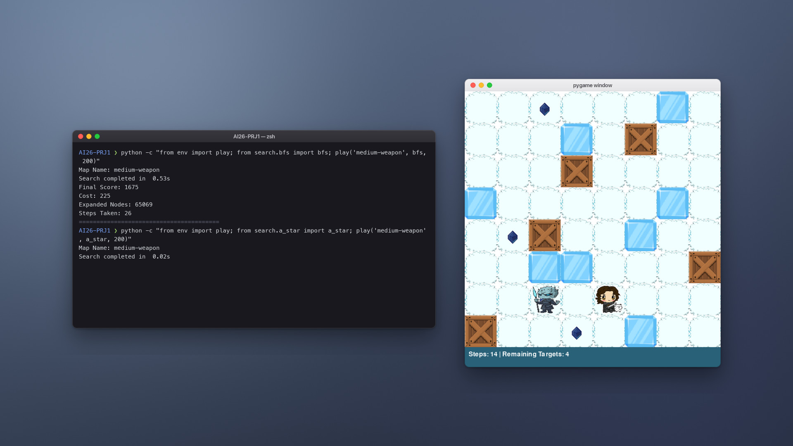
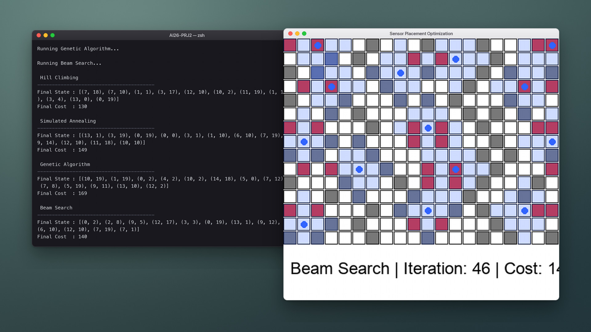
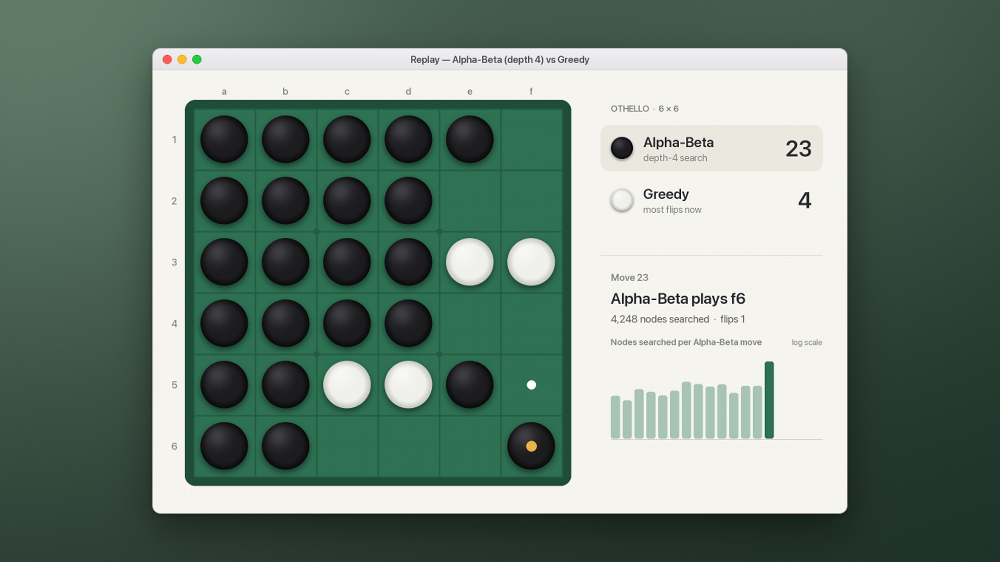
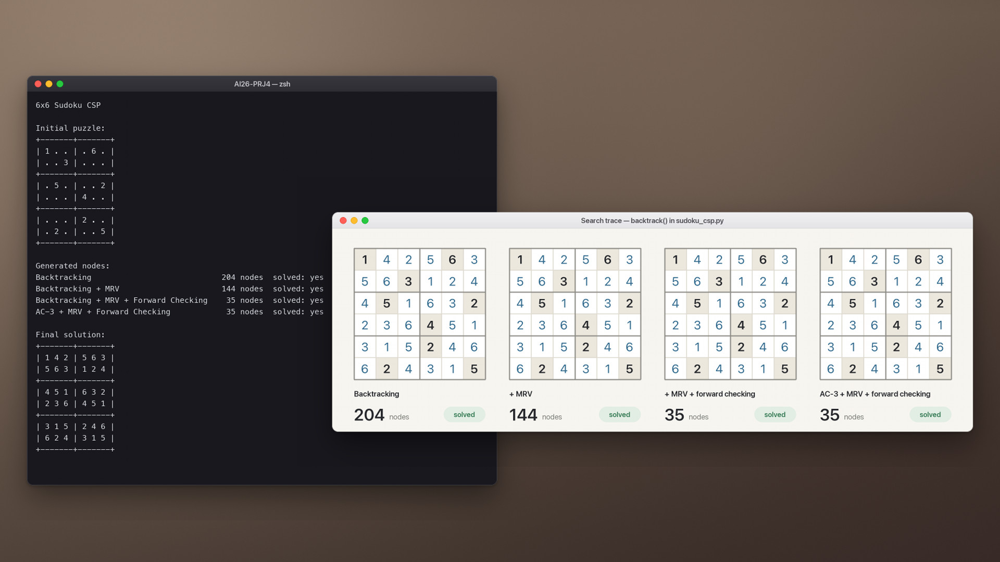
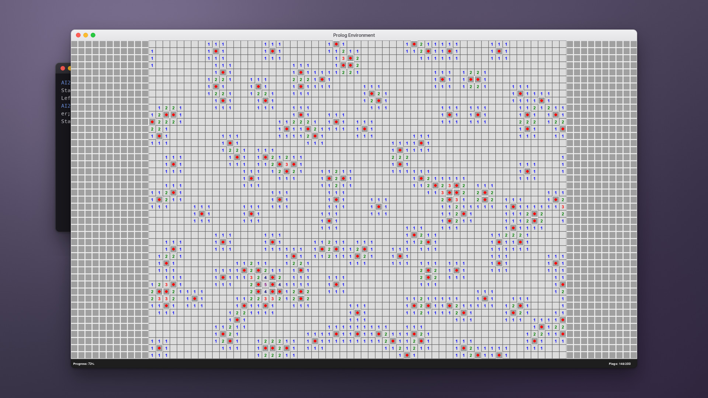

<h1 align="center">AI Projects</h1>

<p align="center">
  Five projects from an undergraduate course in artificial intelligence:<br>
  search, local optimization, adversarial games, constraint satisfaction and logical inference.
</p>

<p align="center">
  <sub>University of Isfahan · Faculty of Mathematics and Statistics · Department of Computer Science · Spring 2026</sub>
</p>

<br>

<table>
  <tr>
    <td width="46%" valign="top">
      <a href="AI26-PRJ1"></a>
    </td>
    <td valign="top">
      <sub>PROJECT 1</sub><br>
      <a href="AI26-PRJ1"><b>Search in a Grid World</b></a>
      <p>Arya collects dragonglass while the Night King walks his patrol. Breadth-first, iterative deepening, uniform-cost and A* search over a state that includes the enemy's position in time.</p>
      <sub>On <code>medium-weapon</code>, A* finds the optimal route after expanding 26 nodes; uniform-cost search needs 40,067.</sub>
    </td>
  </tr>
  <tr>
    <td width="46%" valign="top">
      <a href="AI26-PRJ2"></a>
    </td>
    <td valign="top">
      <sub>PROJECT 2</sub><br>
      <a href="AI26-PRJ2"><b>Placing Sensors with Local Search</b></a>
      <p>Cover every target with as few sensors as possible. Hill climbing with restarts, simulated annealing, a genetic algorithm and local beam search on seven maps.</p>
      <sub>Hill climbing with restarts reaches the lowest cost on six of the seven maps; simulated annealing does best on the seventh.</sub>
    </td>
  </tr>
  <tr>
    <td width="46%" valign="top">
      <a href="AI26-PRJ3"></a>
    </td>
    <td valign="top">
      <sub>PROJECT 3</sub><br>
      <a href="AI26-PRJ3"><b>Adversarial Search in Othello</b></a>
      <p>Minimax and alpha-beta agents on a 6 × 6 board, with an evaluation built on mobility, corners, edges and frontier discs, plus exact endgame search.</p>
      <sub>At depth 4, alpha-beta searches less than a tenth of minimax's nodes and makes the same moves.</sub>
    </td>
  </tr>
  <tr>
    <td width="46%" valign="top">
      <a href="AI26-PRJ4"></a>
    </td>
    <td valign="top">
      <sub>PROJECT 4</sub><br>
      <a href="AI26-PRJ4"><b>Constraint Satisfaction</b></a>
      <p>A 6 × 6 Sudoku and an exam timetable solved by backtracking, adding MRV, the degree heuristic, forward checking and AC-3 one step at a time.</p>
      <sub>Forward checking cuts the Sudoku search from 204 nodes to 35.</sub>
    </td>
  </tr>
  <tr>
    <td width="46%" valign="top">
      <a href="AI26-PRJ5"></a>
    </td>
    <td valign="top">
      <sub>PROJECT 5</sub><br>
      <a href="AI26-PRJ5"><b>Minesweeper, Solved with Logic</b></a>
      <p>An agent that encodes what it has seen as first-order facts and lets pyDatalog rules decide which cells are safe and which are mines.</p>
      <sub>In the demo it clears a 45 × 80 board with 200 mines by deduction alone.</sub>
    </td>
  </tr>
</table>

Each project folder has its own README with the method, results and a demo video.

## Getting started

Everything is plain Python. Use Python 3.11 or newer; the demos were recorded with 3.12. Every project is self-contained:

```bash
git clone https://github.com/elham-cheraghi/AI-Projects.git
cd AI-Projects/AI26-PRJ1
python -m venv .venv && source .venv/bin/activate
pip install -r requirements.txt
python main.py
```

| Project | Dependencies | Run |
| :-- | :-- | :-- |
| [1 · Search](AI26-PRJ1) | `pip install -r requirements.txt` | `python main.py` |
| [2 · Local search](AI26-PRJ2) | `pip install -r reqirements.txt` | `python main.py` |
| [3 · Othello](AI26-PRJ3) | none | `python main.py` · `python run_experiments.py` |
| [4 · CSP](AI26-PRJ4) | none | `python sudoku_csp.py` · `python exam_scheduling_csp.py` |
| [5 · Minesweeper](AI26-PRJ5) | `pip install pygame pyDatalog` | `python main.py` · `python manual.py` |

## Repository

```
AI-Projects/
├── AI26-PRJ1/   Search in a Grid World
├── AI26-PRJ2/   Placing Sensors with Local Search
├── AI26-PRJ3/   Adversarial Search in Othello
├── AI26-PRJ4/   Constraint Satisfaction
└── AI26-PRJ5/   Minesweeper, Solved with Logic
```

Inside each project, `media/` holds the demo video and screenshots, and `report/` holds the full write-up in Persian (PDF and LaTeX).

## About the demos

The videos come from the real programs. Each program ran while its rendered frames and terminal output were captured, and the result was edited into a single take with a scripted pointer. Sped-up and time-lapsed passages are labelled on screen. Projects 3 and 4 run in the terminal, so their board and graph views are drawn from the moves, search traces and output those programs produced.

## Course and team

**Artificial Intelligence**, University of Isfahan, Faculty of Mathematics and Statistics, Department of Computer Science, second semester of 1404–1405 (Spring 2026).

Instructor: Dr. Faria Nasiri Mofakham<br>
Teaching assistants: MehrAzin Marzough, Mohammad Karimi, Anahita Honarmandian

Built by **Zahra Cheraghi**, **Mohammad Mallaee** and **Fatemeh Saeidi**.
